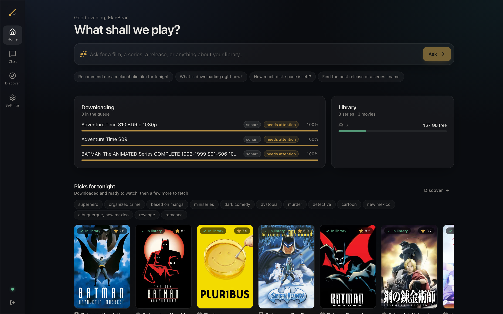
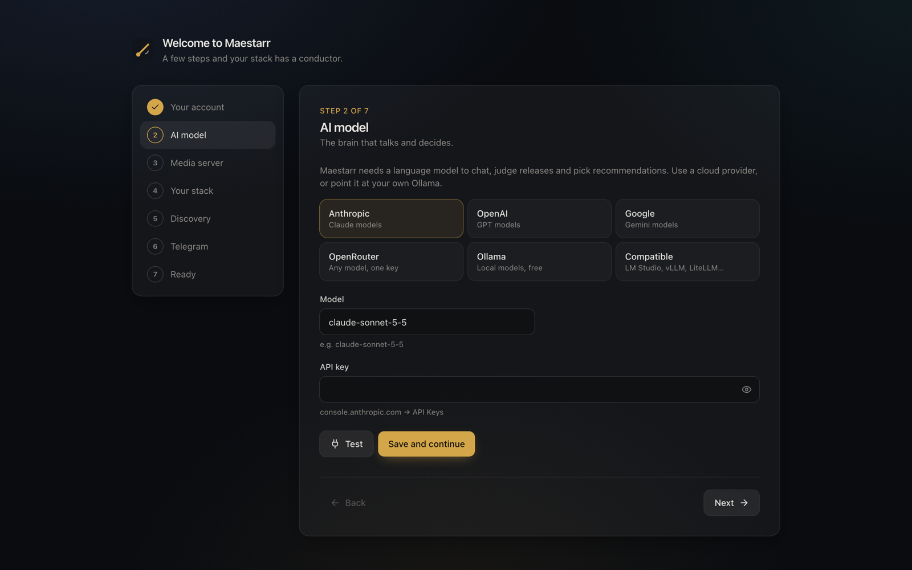
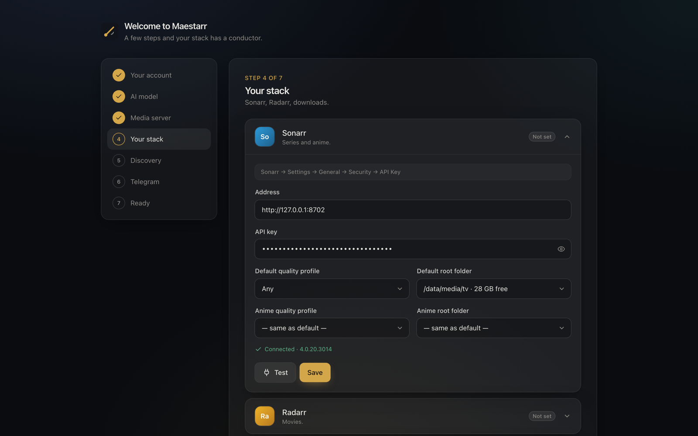
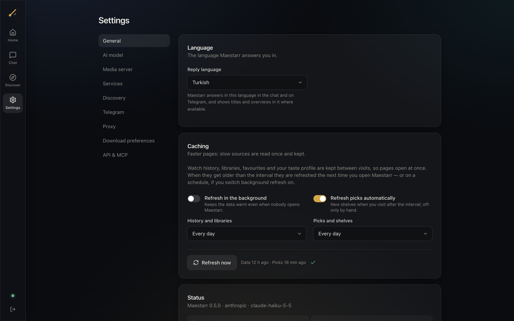
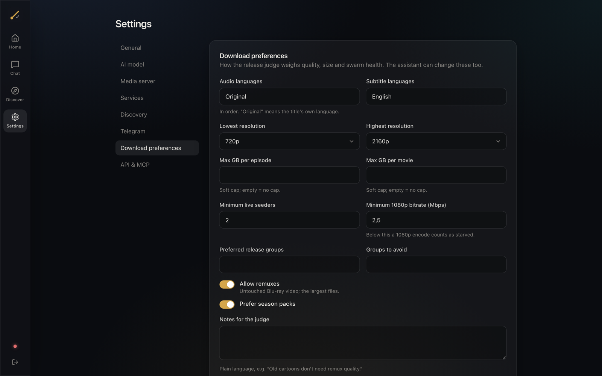
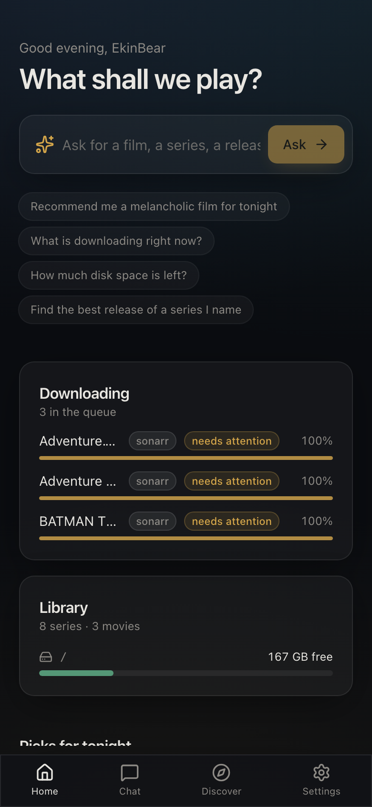

<p align="center">
  
</p>

<h1 align="center">Maestarr</h1>

<p align="center">
  <b>An AI conductor for your *arr stack.</b><br />
  Chat with your library, get picks from your own watch history, and let it choose the best release —<br />
  after looking inside the torrent and checking the live swarm.
</p>

<p align="center">
  <a href="LICENSE"></a>
  
  
  
</p>

<p align="center">
  
</p>

Maestarr sits next to Sonarr, Radarr, Prowlarr, qBittorrent and Jellyfin and
adds the judgement they cannot make on their own. Every action still goes
through their APIs, so your quality profiles, history and hardlinks keep
working exactly as before — and nothing is downloaded, added or deleted
without your approval.

> [!NOTE]
> **Vibecoded.** Maestarr is built largely by prompting an AI coding agent
> (Claude Code) and reviewing what it writes. It has tests and runs on a real
> stack, but read the code before you trust it with your library. Issues and
> pull requests are very welcome.

## Features

- **Chat** with your stack in the web UI, on **Telegram**, or from any **MCP**
  client (Claude Desktop, Claude Code, …).
- **Release judge** — for the best candidates of an interactive search it reads
  the real file list (without downloading), scrapes the trackers for **live**
  seeders, and checks episode coverage, packs that hide another show,
  executables and junk, and the bitrate a size implies. Then it picks one and
  says why.
- **Pack surgery** — download only the files you need from a big pack and
  import them into the right series.
- **Recommendations from your history** (Jellyfin, Trakt, AniList, Letterboxd)
  with moods — *melancholic*, *cozy*, *mind-bending* — TMDB metadata and IMDb
  ratings. Titles you already own are flagged as an easy “watch tonight”. With no
  history yet, your Sonarr/Radarr library stands in for it.
- **Picks as cards** — when the assistant recommends something, the chat shows
  a swipeable row of cards: the poster Sonarr/Radarr use, a description, the
  reason it was picked, and a **Search** button that adds the title and judges
  its releases.
- **Library control** — add, search, check the queue and disks, delete what
  you watched (and the torrents still holding its data).
- **Approval first** — every change waits for your approval: a card in the UI,
  buttons in Telegram, a destructive flag over MCP.
- **Set up in the browser** — a guided first run, with a connection test for
  every service and every setting editable later. No config files. Telegram
  pairs itself: test the bot token, send `/start`, done.
- **Adult content behind one switch** — off by default. While it is off,
  Maestarr never contacts Whisparr or StashDB and shows no adult results. When
  it is on, Discover gets an Adult tab with new scenes from the studios and
  performers in your Whisparr library.
- **Any model** — Anthropic, OpenAI, Google, OpenRouter, a local Ollama, or any
  OpenAI-compatible server.

## Screenshots

| Onboarding | Service setup |
| --- | --- |
|  |  |
| **Status** | **Download preferences** |
|  |  |

<p align="center"></p>

## Supported apps

| App | Used for | Required |
| --- | --- | --- |
| [Sonarr](https://sonarr.tv) v4 | series and anime: search, grab, import, delete | one of Sonarr/Radarr |
| [Radarr](https://radarr.video) v5+ | movies | one of Sonarr/Radarr |
| [qBittorrent](https://www.qbittorrent.org) 4.6+ / 5.x | torrent contents, file selection, live swarm | recommended |
| [Prowlarr](https://prowlarr.com) | free-text searches for complete-series packs | optional |
| [Jellyfin](https://jellyfin.org) 10.10+ / 12 | watch history for recommendations | recommended |
| [TMDB](https://www.themoviedb.org) | titles, themes and posters | recommended |
| [OMDb](https://www.omdbapi.com) | IMDb ratings | optional |
| [Trakt](https://trakt.tv), [AniList](https://anilist.co), Letterboxd export | more history | optional |
| [Whisparr](https://whisparr.com) v3, [StashDB](https://stashdb.org) | adult content — only while the 18+ switch is on | optional |
| Telegram | chat from your phone | optional |

## Installation

Maestarr ships as one Docker image (the web UI is built into it).

```yaml
# compose.yml
services:
  maestarr:
    image: maestarr:local
    build: https://github.com/ekinbasarkomur/Maestarr.git
    container_name: maestarr
    restart: unless-stopped
    volumes:
      - ./data:/data            # settings, conversations, logs
    ports:
      - "127.0.0.1:8709:8709"
    networks:
      - arr                     # the network your Sonarr/Radarr are on

networks:
  arr:
    external: true
```

```bash
docker compose up -d
```

Open **http://127.0.0.1:8709** and follow the setup: create your account,
pick an AI provider, then connect your apps — on the same Docker network they
are reachable by name (`http://sonarr:8989`, `http://radarr:7878`,
`http://qbittorrent:8080`).

> [!IMPORTANT]
> Maestarr can add and delete things in your library. Keep it on a trusted
> network or behind a reverse proxy with TLS.

### Without Docker

```bash
git clone https://github.com/ekinbasarkomur/Maestarr.git && cd Maestarr
python3.12 -m venv .venv && .venv/bin/pip install -e .
(cd ui && npm ci && npm run build)
.venv/bin/maestarr serve        # http://127.0.0.1:8709
```

## Configuration

Everything is configured in the web UI and stored in Maestarr's SQLite
database. Only a few startup values are environment variables:

| Variable | Default | |
| --- | --- | --- |
| `MAESTARR_DATA_DIR` | `/data` in Docker | database, preferences, logs |
| `MAESTARR_HOST` / `MAESTARR_PORT` | `0.0.0.0` / `8709` | where the server listens |
| `MAESTARR_LOG_LEVEL` | `INFO` | |

Any other setting may also be given as an environment variable (see
[`.env.example`](.env.example)) — useful for automated deployments. Values
saved in the UI take precedence.

## MCP and Telegram

- **MCP** — create an API key under *Settings → API & MCP* and point your
  client at `http://<maestarr>/mcp` (streamable HTTP, `Authorization: Bearer`).
  The Settings page shows a ready-made config. Local clients can also run
  `maestarr serve-mcp` over stdio.
- **Telegram** — create a bot with @BotFather and paste its token under
  *Settings → Telegram*. Send `/start` to the bot: it replies with your chat id
  to allow. Downloads and deletions arrive as approve/deny buttons.

## Command line

```text
maestarr serve        web UI, API, MCP endpoint and Telegram bot
maestarr doctor       which integrations are configured and reachable
maestarr judge        judge releases for a season or movie (read-only)
maestarr recommend    recommendations from your history
maestarr serve-mcp    MCP over stdio
```

## Roadmap

- [x] Release judge with file lists and live tracker scrape
- [x] Chat agent with approval-gated tools (web, Telegram, MCP)
- [x] Recommendations from history and moods
- [x] Browser-based setup and settings
- [x] Guided Telegram setup: test the bot token, then send `/start` to the bot and Maestarr picks up the chat ID itself
- [ ] "Maestarr picks" collections synced into Jellyfin, Plex and Emby
- [ ] Jellyfin plugin: chat inside the Jellyfin web UI
- [ ] Plex connector (history, collections, webhooks) and Emby plugin
- [ ] Transmission and Deluge support
- [ ] Published Docker image and releases

Research on media-server plugins: Jellyfin server plugins are official and a
chat page is possible through community plugins (Plugin Pages / File
Transformation); Emby supports plugin pages; Plex no longer has a plugin
system, so it will be integrated through its API instead.

## Development

```bash
.venv/bin/pip install -e ".[dev]"
.venv/bin/python -m pytest          # backend
cd ui && npm ci && npm run verify   # UI: lint, typecheck, tests
npm run dev                         # UI with hot reload on :5173
```

Backend: FastAPI, [pydantic-ai](https://ai.pydantic.dev), httpx, SQLite. UI:
React 19, Vite, Tailwind CSS v4, the Vercel AI SDK. See [`docs/`](docs/) for
how the pieces fit together.

## Disclaimer

Maestarr does not host, index or distribute any content. It automates tools
you already run; you are responsible for what you download and for the laws
where you live.

## Acknowledgements

The recommendation weighting is inspired by
[Curatarr](https://github.com/OrchestratedChaos/curatarr). Maestarr builds on
the [Servarr](https://wiki.servarr.com) projects and the
[TRaSH Guides](https://trash-guides.info).

## License

[GPL-3.0](LICENSE)
